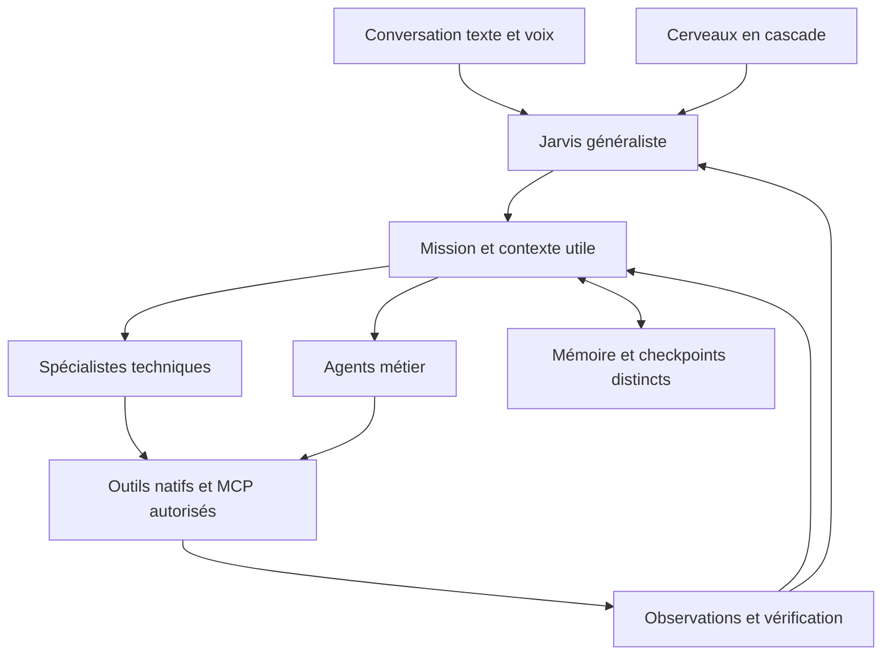

# Architecture de Jarvis : état réel, cible et migration progressive

Décision du 15 octobre 2026, à partir du candidat V12 `c5d0cdd`, du code actuel,
de la recette utilisateur de cette date et de sources techniques primaires.
Cette étude propose l’architecture adaptée à Jarvis ; elle ne prétend pas
désigner une architecture universellement supérieure ni mesurer une intelligence.

## 1. La décision

Jarvis garde une conversation unique et la responsabilité de l’objectif global.
Ses spécialistes sont définis par un rôle, des compétences, un contexte utile,
des outils autorisés et des critères de résultat. Ils réutilisent les services
communs : cerveaux en cascade, mémoire, permissions, missions, preuves et journal.

Le déploiement commence par des profils spécialisés dans le runtime existant.
Les workers avec leur propre contexte et leur propre boucle seront introduits
sur des sous-tâches isolables, après validation des contrats. Les mutations d’une
même fenêtre, d’un même onglet ou d’un même objet métier restent sérialisées.

La cascade conserve Cerebras principal, Cerebras secondaire, Groq, puis les
cerveaux supplémentaires configurés. Un spécialiste n’exige pas une nouvelle
clé ni un modèle différent. Le profil complet garde le grounding Ollama arrêté,
et Skills/Learning désactivés pour la session tant que l’opérateur ne les active
pas explicitement.

Ce graphe exprime la cible et les responsabilités. Une boîte ne signifie pas
qu’un processus autonome supplémentaire tourne déjà.

## 2. Les mots à distinguer

| Élément | Rôle | Exemple |
| --- | --- | --- |
| Cerveau / modèle | Raisonnement et choix d’actions | Cerebras, Groq, cerveau supplémentaire configuré |
| Agent | Responsabilité, contexte et périmètre d’outils | Browser, Windows, MS Football |
| Compétence | Résultat que le rôle sait poursuivre | Préparer un dossier joueur ou vérifier un document |
| Outil | Opération concrète avec schéma d’entrée/sortie | `browser_observe_dom`, `msf_query_records` |
| Connecteur / MCP | Transport et exposition d’outils d’un service | GitHub, Gmail ou service métier connecté |
| Skill | Procédure réutilisable chargée sur demande | Méthode précédemment validée ; opt-in |
| Apprentissage | Création/révision contrôlée de procédures | Opt-in distinct de la mémoire personnelle |
| Mission | Objectif, contraintes, étapes, résultats et reprise | Une demande suivie sur plusieurs échanges |
| Vérification | Évaluation d’un résultat à partir de preuves | Valeur relue, URL observée, objet métier retrouvé |

Une compétence peut employer plusieurs outils et plusieurs spécialistes. Un
modèle supplémentaire n’est pas automatiquement un nouvel agent. La présence
d’un service dans le catalogue ne donne ni connexion ni autorisation.

## 3. Comparaison des architectures

| Option | Avantage pour Jarvis | Limite | Décision |
| --- | --- | --- | --- |
| Agent central avec tous les outils | Continuité simple et réutilisation de l’existant | Catalogue et contexte trop larges, choix d’outils moins précis | Socle actuel à améliorer par exposition ciblée |
| Jarvis coordonnateur et profils spécialisés | Responsabilités explicites, contexte adapté, même expérience utilisateur | Contrats et suivi de délégation nécessaires | Architecture retenue progressivement |
| Workers indépendants avec contextes séparés | Recherche ou analyse indépendante ; isolation d’un domaine | Plus de requêtes, coordination et reprise plus complexes | Étape suivante sur tâches adaptées |
| Réseau libre d’agents qui se passent le contrôle | Flexibilité pour certains workflows | Autorité diffuse, risques de doublons et de coûts difficiles à suivre | Pas de changement du runtime par défaut vers ce modèle |
| Réécriture immédiate dans un framework | Fournit des primitives d’orchestration | Migration du Windows réel, des permissions et des preuves à revalider | Aucune dépendance de framework ajoutée par V13 |

Les recommandations d’[Anthropic sur les agents](https://www.anthropic.com/engineering/building-effective-agents)
privilégient une composition simple, des outils compréhensibles et l’évaluation
par observations de l’environnement. Les spécialistes deviennent utiles quand
la séparation de contexte ou du travail apporte une amélioration mesurée.

La [documentation multi-agent de LangChain](https://docs.langchain.com/oss/python/langchain/multi-agent)
distingue sous-agents, handoffs, routage et Skills. Elle insiste sur le choix des
informations visibles par chaque rôle et sur le coût des appels supplémentaires.
Pour Jarvis, le point de départ est donc le routage et le contexte ciblé ; une
nouvelle boucle de modèle à chaque clic ajouterait un coût à mesurer.

Le [retour d’expérience sur la recherche multi-agent](https://www.anthropic.com/engineering/multi-agent-research-system)
montre l’intérêt de tâches parallèles indépendantes, mais décrit aussi le coût
en tokens et les difficultés de coordination. Ces résultats concernent leur
système et ne constituent pas un benchmark de Jarvis. Notre recommandation
limite initialement le parallélisme aux lectures et analyses isolables.

La [persistance LangGraph](https://docs.langchain.com/oss/python/langgraph/persistence)
sépare les checkpoints d’un fil d’exécution des données durables partagées.
Jarvis possède déjà ses propres stores SQLite ; cette distinction conceptuelle
confirme leur séparation sans imposer une migration vers LangGraph.

La [spécification MCP des outils](https://modelcontextprotocol.io/specification/2026-07-28/server/tools)
décrit la découverte, les schémas, la pagination et les indicateurs d’invocation.
Les annotations d’outils externes sont des données non fiables. Elles ne
permettent pas à Jarvis de s’accorder des droits ou de lever un verrou d’effet
incertain. V13 conserve les autorisations et contrôles MCP existants.

## 4. Ce qui existe dans le dépôt

| Responsabilité | Sources existantes | État à interpréter correctement |
| --- | --- | --- |
| Boucle conversation/outils et cascade | `agent_runtime.py`, `brain_cascade.py`, `brain_manager_qt.py` | Runtime utilisé, cascade conservée |
| Catalogue de rôles et compétences | `capability_registry.py`, `kernel_contracts.py` | Manifeste déclaratif ; une inscription ne prouve pas un worker autonome |
| Routage et délégation contrôlée | `agent_router.py`, `capability_planner.py`, contrats 9D–9F | Fondations et chemins contrôlés ; activation/recette distinctes |
| Missions et révisions | `runtime_convergence.py`, `mission_turn_contract.py`, `mission_orchestrator.py` | Objectifs et preuves persistés ; interprétation réparée en V13 |
| Chrome et Windows | `foundation_tools.py`, `browser_core.py`, `windows_perception.py`, `computer_grounding.py` | Actions réelles existantes ; les parcours défaillants restent à retester |
| Mémoire personnelle | Memory Core / Semantic Memory V5 | Écriture explicite et rappel après redémarrage observés dans la recette |
| Connexions et permissions MCP | `mcp_server_registry.py`, `mcp_tool_registry.py`, `mcp_activity.py` | Connexion, outil autorisé, tentative et preuve sont distincts |
| Interface et feuille de route | `operator_console.py`, `project_roadmap.py`, `architecture_panel.py` | Vues de données réelles et de déclarations explicitement étiquetées |

Le kernel passif et les propositions de routage ne deviennent pas l’exécuteur
autoritaire par affichage dans l’interface. V13 ne remplace pas la boucle live.
Les allowlists historiques des manifestes et les outils du runtime partagé
sont présentés séparément : leur alignement complet est une condition préalable
à l’activation de nouveaux workers, pas une permission implicite.

## 5. Définir un spécialiste et un agent métier

Le profil cible d’un agent comporte :

- identité et responsabilité ; compétences et limites du domaine ;
- outils natifs et connecteurs autorisés, avec schémas et sources disponibles ;
- règles de confirmation et opérations interdites ;
- contexte de la tâche, scopes de mémoire et séparation des espaces métier ;
- contrat de résultat : données, observations, preuves, incertitudes et reste à faire ;
- budget de temps, de requêtes et de tokens ; conditions d’arrêt et de reprise.

`AgentManifest` et `CapabilitySpec` couvrent déjà une partie de ces champs.
La configuration complète d’un profil et son éditeur ne sont pas annoncés comme
terminés par le nouveau panneau. Ce dernier montre les manifestes actuels et les
outils effectivement répertoriés dans la configuration MCP, sans les modifier.

Pour **MS Football**, une compétence telle que « préparer un dossier joueur »
peut combiner lecture métier, documents, recherche et préparation d’un message.
Le domaine porte les règles de son application ; Jarvis garde la coordination.
Les spécialistes Browser ou Windows interviennent quand l’interface réelle est
nécessaire. Une écriture SQL brute ne remplace pas un workflow métier qui doit
déclencher notifications, historique ou autres effets applicatifs.

Un futur pack métier apporte ces connaissances, capacités et validations dans
un espace identifié. Il ne duplique ni le moteur de mémoire, ni le calendrier,
ni les connexions aux comptes, et ne fige pas des sélecteurs d’écran spécifiques
dans le cœur généraliste.

## 6. Mission et preuve : le contrat cible

Une tâche déléguée doit recevoir un identifiant de mission et d’étape, l’objectif
exact, les contraintes, les références de données, les outils permis et son
budget. Elle retourne des résultats structurés et des reçus, sans auto-certifier
la mission entière.

Les observations conservent leur provenance et leur portée. Un contrôle UIA,
une référence DOM et une identité de document ont une durée de validité. Une
écriture relue ne prouve pas que le document demandé a été créé. Un clic vérifié
ne prouve pas que le résumé demandé a été produit. Une navigation vers un
article peut précéder sa lecture et sa synthèse dans le même objectif.

Les mutations d’un même scope doivent avoir un propriétaire d’exécution unique.
Une reprise exige une observation actuelle et respecte les tentatives déjà
envoyées. Après un résultat inconnu, les preuves et le verrou restent conservés.
Changer de mission libère la conversation ; cela ne résout pas les effets de
l’ancienne mission et ne supprime pas la mémoire.

## 7. Interface V13

L’onglet **ARCHITECTURE** comporte :

- **Architecture** : graphe des responsabilités, état configuré de la mémoire,
  Chrome, Windows, contexte efficient, grounding, Skills et Learning ; raccourcis
  vers missions, cerveaux et connexions ; blocages MCP et accès à leur reçu.
- **Agents et outils** : recherche par agent, compétence, outil ou service ; rôle,
  mode d’exécution, manifeste, outils intégrés, scopes de mémoire, connecteurs,
  droits et état de session observés. Les rôles déclarés et profils futurs sont
  visibles sans les présenter comme des workers disponibles.
- **Développement** : priorité actuelle, étapes, implémentation, état des tests
  et recette Windows. Aucun pourcentage global d’intelligence ou de disponibilité.

Le contrôle affiche maintenant les préférences Skills/Learning existantes et
un bouton **Nouvelle demande**, utilisable sans ouvrir les diagnostics techniques.
Ce bouton détache le suivi courant via le worker existant. Le raccourci MCP ouvre
le journal et sélectionne le reçu ; l’utilisateur reste responsable de sa revue.
Afficher ou filtrer le catalogue ne déclenche aucun appel modèle, connexion ou
autorisation.

## 8. Ordre de migration

1. **V13 — fiabilité et lisibilité** : corriger les reproductions de la recette,
   exposer l’architecture et les états réels ; valider Windows et Linux puis les
   mêmes missions sur le PC. Conserver le baseline et le candidat V12.
2. **Contrats de profils** : aligner manifestes et outils live, vérifier la portée
   des connecteurs, versionner les profils et ajouter un éditeur contrôlé.
3. **Délégation ciblée** : contexte et résultat structurés, budgets partagés,
   isolation par mission et preuves attribuées à chaque étape ; un worker puis
   des lectures parallèles sur tâches indépendantes.
4. **Agents métier** : valider MS Football de bout en bout, puis ajouter les
   autres packs sans changement du moteur généraliste.
5. **Automatisations et cloud** : scheduler durable, exécuteurs isolés,
   gestion des sessions, déploiement, reprise et arrêt ; pas de service permanent
   annoncé avant son implémentation et sa recette.

À chaque étape : tests ciblés sur une reproduction, régression cumulative,
CI Windows/Linux, recette réelle documentée et retour possible au candidat
précédent. Skills et Learning restent facultatifs. La cascade de fournisseurs,
les clés et données existantes, le profil Chrome habituel et le baseline
`feature/native-agent-loop-v2` ne sont pas remplacés.
