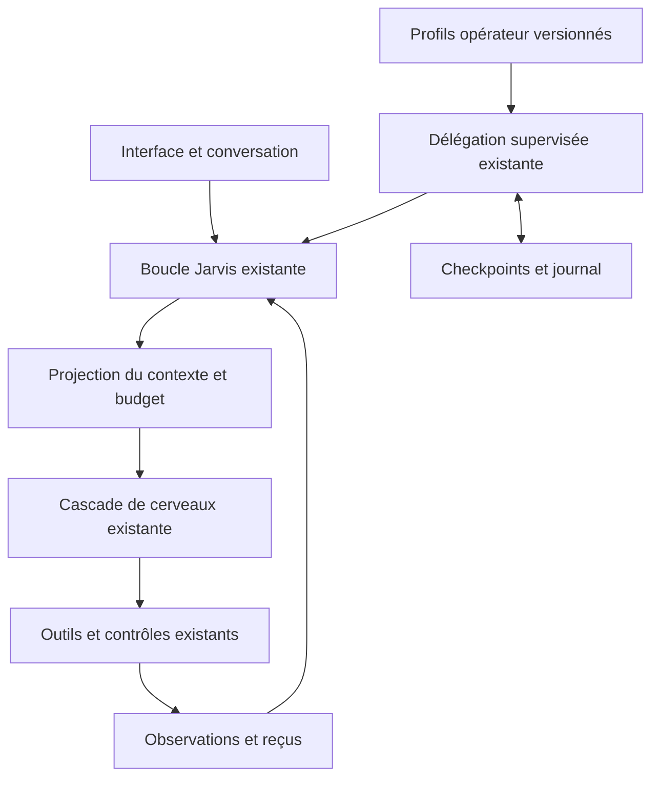

# V14 — profils opérateur et contexte par mission

Base : V13 `75694939721934fd218f4d68f66779afd8d443cc`.
Branche : `feature/agent-profiles-context-v14`.
Le baseline `feature/native-agent-loop-v2` et les candidats V12/V13 sont conservés.

## Architecture et périmètre livré

Jarvis garde son interlocuteur et son exécuteur partagés. V14 ajoute des contrats
configurables aux responsabilités existantes, puis réduit le contexte envoyé
aux fournisseurs. Un profil n’est ni un modèle supplémentaire, ni un worker
indépendant. Aucun framework, modèle, connecteur ou service permanent n’est ajouté.



Les décisions d’architecture restent celles de
[l’étude V13](JARVIS_ARCHITECTURE_V13.md) : coordination centrale pour les missions
composées, exécution directe pour les demandes simples, spécialistes isolés
uniquement lorsqu’ils apportent une séparation utile de contexte ou de travail.

La recherche complémentaire du 15 octobre a notamment vérifié les documentations
officielles de [Hermes](https://hermes-agent.nousresearch.com/docs/developer-guide/architecture),
[OpenHands](https://docs.openhands.dev/sdk/arch/overview),
[OpenClaw](https://docs.openclaw.ai/concepts/architecture),
[Claude Research](https://www.anthropic.com/engineering/multi-agent-research-system)
et [LangGraph](https://docs.langchain.com/oss/python/langgraph/persistence).
Le [papier Agent S3, version du 3 février 2026](https://arxiv.org/html/2510.02250v2)
décrit une boucle GUI sans hiérarchie manager/worker, avec recours possible à
un agent de code. Ce choix conforte une orchestration adaptée à la tâche ; il
ne prouve pas la fiabilité de Jarvis et n’impose pas de remplacer UIA/DOM.

## Ce que révèle la dernière recette V13

Le journal utilisateur portait bien sur `7569493` :

| Parcours | Observation | Conséquence |
| --- | --- | --- |
| Mémoire | Écriture explicite, rappel correct après redémarrage | Persistance confirmée pour ce scénario |
| Nouveau document | Écriture dans l’ancien buffer refusée avant dispatch ; Ctrl+N, valeur vide puis écriture Unicode vérifiée | Protection et reprise observées ; objectif complet encore non certifié |
| GitHub | Identité, branches, commits lus ; PR bloquées sur ancienne tentative #3 | Conserver la revue MCP, ne pas effacer son verrou |
| Nouvelle mémoire après GitHub | Interprétation `continue`, puis RuntimeError ; réussite après détachement local | Éviter l’appel modèle pour cette demande explicite indépendante |
| Recherche navigateur | Recherche Google et DOM observés, puis timeout `browser_find` | Parcours article et résumé encore à valider |
| Fournisseurs | Contexte croissant, 429, Groq écarté avant API, cerveau supplémentaire en erreur ou hors budget | Isoler les nouveaux objectifs et contrôler les requêtes avant l’API |

Le journal ne donne pas une traceback permettant d’attribuer précisément
l’AttributeError après fermeture de fenêtre. V14 ne présente pas ce symptôme
comme définitivement corrigé. Le timeout Browser Bridge et l’erreur HTTP du
cerveau supplémentaire nécessitent aussi leur propre reproduction réelle.

## Profils et éditeur graphique

**ARCHITECTURE > Profils** expose les douze responsabilités existantes : nom,
responsabilité, compétences, sélection d’outils et limites de contexte, appels
modèle, actions et durée. Le bouton dans **Agents et outils** ouvre le profil
correspondant. Les rôles uniquement planifiés ne sont pas configurables ici.

Les paramètres sont enregistrés dans `JarvisPersonal/agent_profiles.json`, sous
le répertoire d’état local. `JARVIS_AGENT_PROFILES_PATH` permet un emplacement
isolé pour les essais. Ce fichier ne possède aucun champ de clé API.

- Schéma validé, bornes explicites, écriture temporaire puis remplacement atomique.
- Révision par rôle ; un éditeur périmé doit recharger avant d’écraser une version.
- Brouillons conservés lors du changement de rôle ; télémétrie sans écrasement des champs.
- `tools=null` conserve le périmètre existant ; `tools=[]` interdit tous les outils de cette délégation.
- Les noms sauvegardés sont intersectés avec le périmètre du rôle, l’affectation du plan
  et les outils disponibles. Une configuration ne découvre ni n’accorde d’outils.
- Un outil MCP exige toujours une affectation explicite et ses droits MCP existants.
- Les capacités du manifeste et les scopes de mémoire sont affichés ; l’isolation
  effective de la mémoire de workers reste à développer.

La délégation supervisée fige la version du profil au début de chaque étape,
y compris lors d’une continuation ou d’une confirmation. Les appels modèle et
actions consomment leur budget avant démarrage. Les limites globales de la mission
restent également appliquées. La vérification indépendante consomme aussi des
actions : un budget trop petit suspend l’étape, même après une écriture réussie.

La conversation ordinaire ne devient pas automatiquement un groupe de workers.
L’activation de la supervision garde son protocole existant et son plan revu.
Les compétences textuelles orientent le rôle ; elles ne créent pas un nouvel outil.

## Contexte et cascade

Un nouveau suivi explicite ou un détachement prépare une frontière dans les
requêtes du provider Chat Completions existant. Le prochain message humain devient
le début du contexte de ce nouvel objectif. La conversation conservée en mémoire
du runtime et les checkpoints SQLite ne sont pas réinitialisés.

Une confirmation en attente appartient à l’objectif précédent. Lors du changement,
elle reçoit un reçu local d’annulation sans dispatch ; elle ne peut pas approuver
une action du nouvel objectif. Les verrous d’effets incertains et les droits des
registres d’outils restent en place.

Une demande de fait explicite (« Retiens que… », « Remember that… »), après une mission non mémoire,
peut détacher celle-ci localement, sans interprétation modèle. Une demande mêlant
mémoire et action externe conserve l’interprétation et les contrôles ordinaires.
Une référence telle que « mémorise cette information » garde aussi le contexte
de la mission à laquelle elle renvoie.

Les lectures historiques réussies peuvent devenir des reçus relisibles via
`read_observation_evidence`. Les appels/réponses restent associés ; les préconditions,
mutations, échecs et effets incertains ne sont pas tronqués pour faire tenir un prompt.
Des passes successives de compression préservent la résolution des références archivées.
L’archive est locale au processus et n’est pas une nouvelle mémoire persistante.

Les requêtes Cerebras/Groq et cerveaux supplémentaires passent un contrôle local
avant leur envoi quand le contexte efficient est actif. La délégation supervisée
applique aussi le plafond du profil. La cascade garde son ordre et ses cooldowns.
Les requêtes de contrôle JSON sans outils gardent leur contexte séparé existant.

Le compteur d’usage supervisé reconnaît aussi les fournisseurs du registre des
cerveaux supplémentaires. Un test reproduit l’ancien rejet de `gemini`, qui
transformait un retour modèle valide en suspension avant l’appel suivant.
Les identifiants de fournisseurs inconnus restent refusés. Cette correction de
télémétrie ne change ni les clés, ni les scopes, ni les autorisations cloud mémoire.

`JARVIS_REQUEST_ESTIMATED_TOKEN_BUDGET` règle le plafond général, à 12000 par défaut.
Le plafond Groq existant et les plafonds des cerveaux supplémentaires restent en
place. Sous pression, le runtime réduit l’exposition des schémas et conserve les
outils forcés, la mémoire explicitement demandée, la consultation du catalogue et
les primitives suivantes du navigateur ou du bureau. Les contrôles d’exécution
restent indépendants de cette exposition.

Si les éléments protégés dépassent encore la limite, la requête est suspendue
avant API. L’interface explique le budget et garde la mission ; elle ne conseille
plus systématiquement de reconfigurer le modèle pour ce cas.
**Architecture** montre l’estimation de la dernière requête et son admission.
Ces estimations ne sont ni un tokenizer exact ni des tokens facturés mesurés.

## Validation et limites

Validation locale du candidat : **1414 tests examinés**, dont **1404 réussis**
et **10 exclusions Windows explicites**, sans échec ni erreur. Les **46 tests
Browser Bridge** passent, ainsi que le contrat d’import du SDK MCP officiel.
Ce lot ajoute **30 tests** à la V13. La CI Windows/Linux sur le commit publié
est suivie dans la pull request ; ces chiffres locaux ne certifient pas le vrai bureau.

Les essais couvrent stockage/rechargement, conflits de révision, refus de champs
inconnus, bornes, périmètres vides, absence de droits implicites, budgets avant
dispatch, profil figé, sauvegarde Qt et géométrie étroite. Les cas de contexte
couvrent changement de mission, continuation, annulation d’une ancienne confirmation,
archives relisibles, conservation des mutations incertaines, arrêt avant l’API,
outils forcés et cascade jusqu’au cerveau supplémentaire.

La régression cumulative isole aussi les profils : aucun paramètre personnel
n’est lu ou écrit par ces tests. Les essais automatisés ne remplacent pas la
recette du vrai Windows, du navigateur connecté et des fournisseurs personnels.

## Essai Windows

Depuis le checkout de test existant, fermer Jarvis puis exécuter :

```powershell
$ErrorActionPreference = 'Stop'
cd D:\Django_Projects\jarvis-main\jarvis-mcp-test
if (git status --porcelain --untracked-files=no) { throw 'Modifications locales à préserver.' }
git fetch origin
if ($LASTEXITCODE) { throw 'Échec de récupération GitHub.' }
git switch --detach origin/feature/agent-profiles-context-v14
if ($LASTEXITCODE) { throw 'Échec de sélection de la V14.' }
.\scripts\run_p0_acceptance.ps1 -Full -EnvPath 'D:\Django_Projects\jarvis-main\jarvis-main\.env'
```

Le nom historique « V12 full profile » du lanceur n’indique pas la version du
code : lire le commit affiché sur la même ligne. La mémoire directe/V5, Chrome
habituel et UIA/OCR restent actifs ; grounding Ollama, Skills et Learning restent
désactivés dans ce profil de recette. Les clés et les données existantes sont conservées.

1. Dans **Architecture > Profils**, modifier un nom et un budget, enregistrer,
   puis redémarrer : retrouver la version. Cela ne lance aucune mission.
2. Après une mission GitHub bloquée, demander une nouvelle mémorisation explicite :
   elle doit réussir sans redémarrer et sans résoudre l’ancienne tentative MCP.
3. Passer de Bloc-notes à une nouvelle recherche : vérifier les lignes
   `mode=mission_request_budget`, puis poursuivre jusqu’à l’article et sa synthèse.
4. Continuer une mission : conserver ses contraintes, ses effets déjà vérifiés
   et ses incertitudes, sans rejouer une mutation.
5. La délégation contrôlée garde son activation explicite ; vérifier un profil
   restreint et un budget bas sur un plan d’essai avant une mission métier.

Prochaine étape : un spécialiste avec contexte séparé pour une lecture indépendante,
résultat structuré et preuve attribuée à l’étape ; ensuite les packs métier et
la planification durable. V14 ne présente pas ces fonctions comme terminées.
