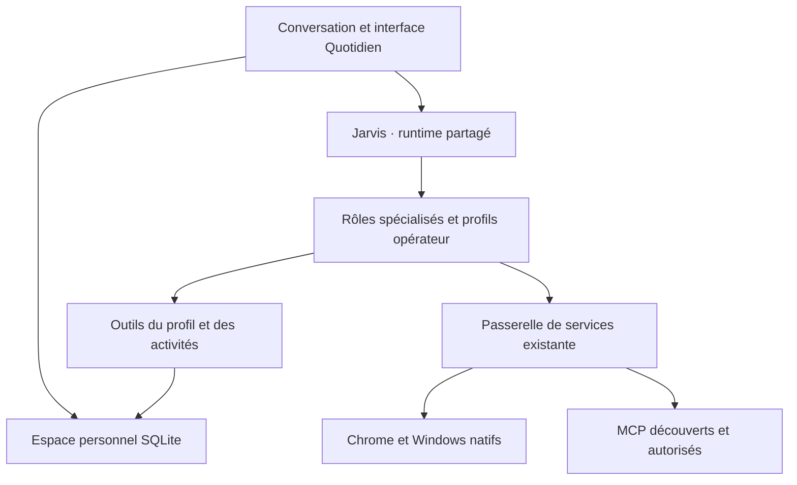

# V16 — Jarvis connaît le contexte choisi et organise les activités

Branche : `feature/personal-workspace-daily-v16`, issue de V15 `88c952b`.
Les données, réglages et correctifs des versions précédentes sont conservés.
La connexion des comptes MCP peut se faire après ce développement.

## Ce qui est utilisable

**QUOTIDIEN** est accessible directement dans les onglets principaux, ou par
**ARCHITECTURE > Mon quotidien**. Ses cinq pages utilisent des données réelles
enregistrées localement, sans compte externe nécessaire.

| Page | Usage |
| --- | --- |
| Aujourd’hui | Échéances à reprendre, activités du jour, sept prochains jours, attentes et tâches sans date ; accès au dossier et demande d’organisation à Jarvis |
| Activités | Créer, retrouver et modifier une tâche, un rendez-vous ou un suivi ; domaine quotidien, football, MS Football ou logiciel ; personne/projet, date, heure, priorité, statut et contraintes |
| Mon profil | Nom choisi, rôles, fuseau, projets, priorités et préférences ; activation volontaire de l’extrait transmis aux cerveaux |
| Préparations | Conserver le service, l’action et les instructions exactes avant de confier le dossier à Jarvis |
| Services | Voir les services prévus et leur état observé ; associer un service à un serveur MCP existant ou futur ; ouvrir le centre de connexions |

Les actualisations ne remplacent pas une saisie en cours. Une modification
concurrente est refusée avec une invitation à recharger l’élément. Les pages
défilent verticalement dans les panneaux étroits de Windows.

## Architecture intégrée



Un seul Jarvis reçoit la demande ; les rôles restent dans le runtime partagé.
Cette version ne démarre pas de nouveaux workers indépendants. Les compétences
et restrictions de chaque profil opérateur restent applicables à la délégation.

| Outil local | Contrat |
| --- | --- |
| `workspace_read` | Lire profil, journée, activités, préparations et état des services ; aucune requête aux comptes externes |
| `workspace_save_activity` | Créer ou modifier une activité locale demandée par l’utilisateur ; relire la révision avant une modification |
| `workspace_update_profile` | Modifier le profil après la confirmation existante du runtime ; aucune identité déduite automatiquement |
| `workspace_prepare_action` | Enregistrer une intention locale ; aucun appel, envoi, réservation ou déploiement externe |

L’outil de lecture est proposé au début du tour. Les autres capacités se
sélectionnent par le mécanisme existant ; les corrections V15 de conservation
des schémas et de mémoire récente restent en place. Le profil est rafraîchi au
tour suivant et conservé dans la cascade de fournisseurs existante.

## Profil, dates et conservation

Le profil commence vide et son inclusion automatique est désactivée. Aucune
information de ChatGPT ou d’un compte connecté n’est importée automatiquement.
L’utilisateur choisit ce qu’il enregistre. Quand l’option d’inclusion est active,
un extrait borné rejoint les requêtes envoyées aux cerveaux configurés. Jarvis
peut également lire le profil sur demande explicite.

Les activités et le profil sont des données, jamais une autorisation d’action.
Les longues listes sont paginées ; les fiches volumineuses sont relisibles par
fragments avec leur révision, sans tronquer la source enregistrée. Les journaux
diagnostiques masquent les paramètres et contenus des outils de l’espace.

Les dates sont des dates locales `AAAA-MM-JJ`, les heures `HH:mm` dans le fuseau
enregistré. Le fuseau initial est UTC ; choisir par exemple `Africa/Abidjan` ou
`Africa/Tunis` dans le profil. `tzdata` fournit les règles IANA sous Windows.
La vue quotidienne calcule ses groupes dans ce fuseau. Les groupes peuvent se
recouper : un suivi en attente peut aussi être en retard.

Le fichier distinct `personal_workspace.sqlite3` se trouve dans les données
Jarvis habituelles ; `JARVIS_PERSONAL_WORKSPACE_PATH` permet de le déplacer.
Les lectures seules ne créent pas de base. Les écritures sont transactionnelles,
versionnées et historisées. Un appel de création identique répété dans le même
tour est dédupliqué. La mémoire V5 et les missions gardent leurs propres stores.

## Relier les MCP ensuite

1. Dans le centre **MCP**, configurer le serveur réel, découvrir ses outils et
   régler les accès comme auparavant.
2. Dans **QUOTIDIEN > Services**, associer le service au bon identifiant de
   serveur si celui-ci diffère de l’identifiant prévu au catalogue. Plusieurs
   services peuvent partager le même serveur. L’association n’accorde aucun droit.
3. Ouvrir une préparation puis **Confier à Jarvis** : le runtime doit relire la
   fiche, inspecter les vrais outils, effectuer les confirmations nécessaires et
   vérifier le résultat effectivement obtenu.

L’état « Outils exposés · accès à vérifier » indique des schémas disponibles et
autorisés ; il ne certifie ni authentification active ni capacité à accomplir
l’opération prévue. Les préparations ne sont jamais rejouées automatiquement
lorsqu’un serveur devient disponible. Une exécution distante ne synchronise
pas automatiquement le statut local de la préparation.

## Essai Windows

Dans la copie de test habituelle, avec les modifications locales préservées :

```powershell
$ErrorActionPreference = 'Stop'
cd D:\Django_Projects\jarvis-main\jarvis-mcp-test
if (git status --porcelain --untracked-files=no) { throw 'Modifications locales à préserver.' }
git fetch origin
if ($LASTEXITCODE) { throw 'Échec de récupération GitHub.' }
git switch --detach origin/feature/personal-workspace-daily-v16
if ($LASTEXITCODE) { throw 'Échec de sélection de la V16.' }
& 'C:\jv312\Scripts\python.exe' -m pip install 'tzdata>=2025.1'
if ($LASTEXITCODE) { throw 'Installation des fuseaux horaires impossible.' }
.\scripts\run_p0_acceptance.ps1 -Full -EnvPath 'D:\Django_Projects\jarvis-main\jarvis-main\.env'
```

Compléter **QUOTIDIEN > Mon profil**, choisir le fuseau et enregistrer. Puis :

- « Ajoute une activité football demain à 18 h : séance et récupération. »
- « Ajoute un suivi MS Football : attendre les vidéos du joueur, priorité haute. »
- « Prépare une relance Gmail pour demander les vidéos ; garde-la locale sans l’envoyer. »
- « Organise ma journée à partir de mes activités. »

Vérifier les fiches dans l’interface, modifier une échéance, fermer puis rouvrir
Jarvis : les données doivent rester présentes. La relance doit rester une
préparation locale, sans envoi. La recette des régressions V15 reste nécessaire
pour mémoire → recherche et outils Windows.

## Vérification et limites

Les tests utilisent SQLite, les requêtes réelles des classes de fournisseurs et
la passerelle MCP avec modèles/transports simulés. Ils couvrent les révisions,
écritures concurrentes, fuseaux, redémarrage du store, Unicode, budgets de
contexte, déduplication, confidentialité des logs, UI étroite et passage à la
file du worker. Le runner isole aussi le nouveau chemin de données.

Exécuter `python scripts/run_final_regression.py` et
`node --test tests/browser_bridge_replay.mjs`. La CI Windows/Linux complète
sert de contrôle automatique ; elle ne certifie pas une mission sur le poste réel.

Les échéances sont visibles dans Jarvis ouvert. Un service de notifications
permanent, la synchronisation des agendas/comptes, la livraison de messages et
les workers autonomes nécessitent encore leurs intégrations et validations
réelles. Aucun succès externe n’est déduit d’une sauvegarde locale.
