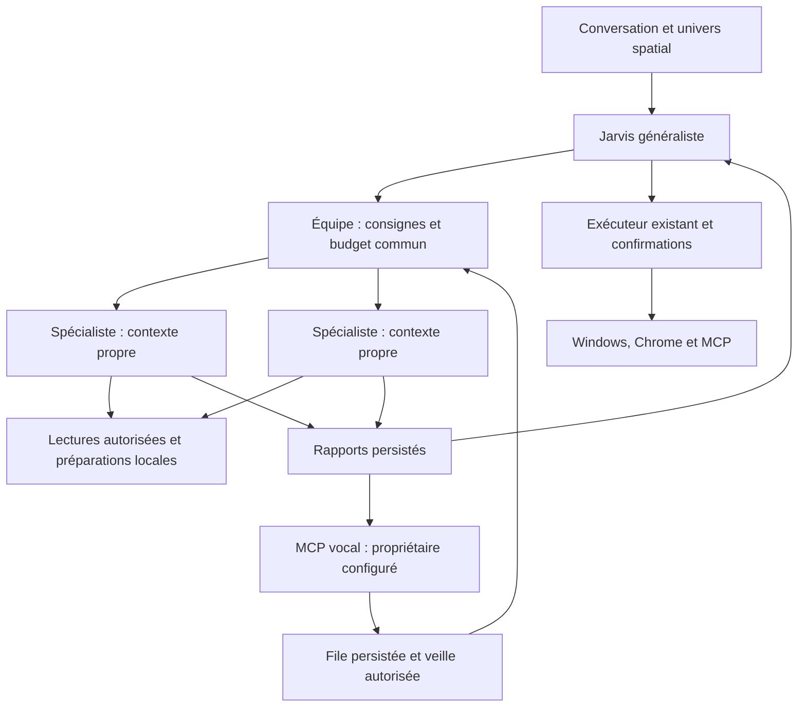

# V17 — Jarvis coordonne son équipe et prépare les prochains travaux

Branche : `feature/orchestra-space-watch-v17`, basée sur V16 `eb3c54c`.
Cette évolution conserve le runtime conversationnel, les réglages des cerveaux,
Chrome habituel, les pilotes Windows, la mémoire V5 et l’espace QUOTIDIEN.
Les comptes MCP peuvent être connectés ensuite.

## Fonctionnement intégré

Jarvis reste l’interlocuteur généraliste. Il peut confier une à quatre demandes
indépendantes à des spécialistes, puis synthétiser leurs rapports. Chaque
demande crée un runtime de modèle, un historique et un contexte d’observation
distincts. Deux spécialistes au maximum travaillent simultanément ; un même
rôle travaille une seule fois à la fois dans cet orchestre.

Cette séparation utilise des threads et des conversations distinctes, sans
sandbox de processus ni machine virtuelle. Les agents n’héritent pas de tout
l’historique du chat : Jarvis doit transmettre les contraintes utiles dans la
consigne. Le profil personnel consenti dans QUOTIDIEN reste disponible.



Les spécialistes consultent les outils de lecture compatibles avec leur rôle
et peuvent créer des activités ou préparations locales. Ils ne peuvent pas
approuver un outil, envoyer un message, modifier un service externe, manipuler
le bureau, appeler quelqu’un ou déléguer récursivement à d’autres agents.
Jarvis réalise les actions externes avec ses outils et confirmations existants.
Un rapport disponible ne certifie ni sa qualité ni l’accomplissement d’un
objectif externe.

Les outils MCP d’un spécialiste exigent une découverte réelle, un serveur actif
et une préautorisation de lecture épinglée sur le schéma actuel. Un nom demandé
dans une consigne ne donne aucun droit. Révoquer une lecture ou changer le
profil interrompt l’accès à l’étape suivante. Les connecteurs hébergés par le
fournisseur de modèle sont exclus des spécialistes : ils utilisent la
passerelle locale contrôlée.

## Interface

| Espace | Usage réel |
| --- | --- |
| Univers central | Jarvis au centre, planètes des rôles et des espaces ; clic pour ouvrir le panneau concerné ; flèches et Entrée au clavier |
| PILOTAGE / Équipe | Sélectionner un rôle, consulter ses compétences et limites, confier une analyse via la file de conversation habituelle, ouvrir son profil |
| PILOTAGE / Veille | Autoriser la veille, régler les budgets, créer un travail ponctuel ou quotidien, annuler un travail non démarré, classer une interruption |
| PILOTAGE / Rapports | Lire la consigne et le rapport complets, voir les compteurs, confier la suite à Jarvis |
| PILOTAGE / Appels | Associer les outils réellement découverts à son contact, régler les autorisations et le quota, demander un essai, consulter les reçus vocaux |
| ARCHITECTURE | Voir le schéma de coordination, les profils et la distinction entre analyse spécialisée et exécution externe |
| QUOTIDIEN | Conserver profil, activités, échéances et préparations locales de V16 |

Les étoiles filantes viennent des départs, retours et appels d’outils observés.
Elles ne simulent pas une activité autonome au repos. Les couleurs et statuts
distinguent analyse, rapport disponible et suspension. En petite fenêtre,
l’univers montre moins de planètes ; toute l’équipe reste accessible dans
PILOTAGE. La case « Afficher l’univers spatial » permet de retrouver le flux
classique. Les contrôles habituels restent l’onglet initial.

Les actualisations préservent les brouillons. Les modifications concurrentes
des travaux et réglages sont refusées plutôt que remplacées silencieusement.
Aucun modèle, transport MCP ou appel téléphonique n’est exécuté sur le thread
graphique.

## Veille et limites

La veille est **OFF au départ**. Elle nécessite Jarvis ouvert, le PC éveillé,
un cerveau configuré et, pour les lectures distantes, les MCP déjà autorisés.
Elle continue pendant que le propriétaire dort ; elle ne réveille pas le PC
et ne déploie pas de service cloud. Les rapports restent silencieux. Une case
par travail peut demander une notification par appel si le canal l’autorise.

| Limite initiale | Valeur |
| --- | --- |
| Équipe interactive | 1 à 4 demandes, 2 spécialistes simultanés |
| Budget commun d’équipe | 8 requêtes de modèle, 16 outils, 180 secondes |
| Travaux programmés | 1 travail en cours, 4 travaux sur 24 heures glissantes |
| Budget par travail programmé | 6 requêtes de modèle, 12 outils, 180 secondes |
| Appels automatiques | 2 réservations sur 24 heures glissantes ; nuit 22 h–7 h interdite par défaut |
| Réception vocale | Relève chaque minute pendant la veille autorisée |

Les limites du profil s’appliquent en plus du budget commun. Chaque requête
primaire, secondaire ou de secours consomme le budget. La durée et l’arrêt
sont vérifiés avant la prochaine requête ou utilisation d’outil : une requête
déjà en vol termine selon le délai du client fournisseur. Désactiver la veille
empêche les prochaines étapes et les notifications automatiques.

Le premier horaire et le fuseau sont enregistrés explicitement. Une répétition
quotidienne utilise ensuite HH:mm dans ce fuseau. Après un retard, elle prépare
une fois le travail puis avance à la prochaine échéance ; elle ne rejoue pas
toutes les occurrences manquées. Au changement d’heure, une heure inexistante
est sautée ; une heure doublée n’est prise qu’à sa première occurrence.

Les réclamations de travail sont transactionnelles en SQLite. Un travail
interrompu reste « en cours / à examiner après interruption », bloque les
nouveaux travaux de veille et n’est pas rejoué au redémarrage. Pour le classer,
désactiver et enregistrer la veille, attendre la fin de la requête en vol, puis
utiliser le bouton d’examen. Reprogrammer est une nouvelle décision explicite.

## Canal vocal à connecter

Le code fournit la liaison au propriétaire, la réception de consignes, la file
de travail et le retour de rapports. Le service MCP choisi doit fournir la
ligne téléphonique, les appels, la transcription, la synthèse vocale et
l’authentification de l’appelant. Une autorisation dans cette interface ne
connecte pas un compte et ne prouve pas que le téléphone répond. Les coûts
dépendent de ce service.

Le contact et les outils sont configurés par l’opérateur, jamais choisis par
un paramètre du modèle. Modifier le serveur, le contact, les champs ou les
schémas invalide l’association. Le runtime MCP, les droits, les quotas et le
journal de résultats incertains restent applicables.

Contrat d’adaptateur accepté par le canal :

| Outil configuré | Entrée |
| --- | --- |
| Appeler | Deux champs chaîne configurables, par défaut `contact_id` et `message` ; `idempotency_key` facultatif |
| Lire les demandes | Aucun paramètre obligatoire ; `cursor` chaîne facultatif |
| Répondre | `event_id` et `message` chaînes ; `idempotency_key` facultatif |

La lecture doit renvoyer l’enveloppe suivante dans `structuredContent` ou dans
une sortie texte JSON. Au maximum 20 événements par page ; `next_cursor` est
facultatif et n’est utilisé que si le schéma accepte `cursor`.

```json
{
  "protocol": "jarvis.voice.v1",
  "next_cursor": "opaque-next-page",
  "events": [{
    "id": "unique-provider-event",
    "contact_id": "configured-owner-id",
    "authenticated": true,
    "occurred_at": "2026-10-16T09:00:00+00:00",
    "text": "Prépare mon bilan du jour sans envoyer de message."
  }]
}
```

Seuls les événements authentifiés du contact exact, datés des dernières
24 heures, sont admis. Une transcription contient au plus 4 000 caractères.
L’archivage d’observation récupère les longues sorties intégralement disponibles
sans rappeler le service ; une sortie tronquée à la source est refusée.
L’identifiant et l’association dédoublonnent les événements, même après
redémarrage. Le curseur avance après leur enregistrement. La consigne devient
un travail de préparation, sans autoriser des mutations externes.

Les réponses automatiques utilisent uniquement l’événement et l’association
d’origine, si cette politique est activée. Un appel soumis au service ne
signifie pas que le destinataire a décroché. Un envoi incertain bloque les
nouveaux envois du même type. Après contrôle du service, désactiver et
enregistrer la veille et le canal, puis classer le dernier envoi incertain.
Une réservation sans reçu ne peut être classée avant dix minutes. Ce classement
ne certifie pas une livraison, ne rejoue rien et ne supprime pas le journal MCP,
dont les blocages doivent être examinés séparément.

La conversation téléphonique temps réel, les interruptions audio et la qualité
de voix dépendent de l’adaptateur : cette version traite des événements
transcrits et des retours de rapports. La recette avec une ligne et un compte
réels reste à faire après connexion.

## Architecture du code et données

| Module | Responsabilité |
| --- | --- |
| `orchestra_workers.py` | Contextes séparés, profils, filtrage des outils, parallélisme et rapports |
| `orchestra_budget.py` | Limites communes et par rôle, arrêt aux frontières des requêtes/outils |
| `orchestra_store.py` | Travaux, révisions, prises en charge atomiques, rapports, événements et réservations vocales |
| `orchestra_tools.py` | Outils du chef d’orchestre : lire, déléguer, programmer et appeler son propriétaire |
| `orchestra_service.py` | Boucle de veille séparée de la conversation et de l’interface |
| `orchestra_voice.py` | Association MCP vocale, contact fixe, réception, dédoublonnage et reçus |
| `space_universe.py`, `orchestra_panel.py` | Univers et pilotage Qt natifs |

Les données résident dans `orchestra.sqlite3`, à côté de l’espace personnel.
`JARVIS_ORCHESTRA_PATH` permet de choisir un autre emplacement. Une simple
lecture ne crée pas le fichier. La mémoire V5 et les préférences existantes ne
sont ni migrées ni réécrites. Les rapports complets restent consultables par
identifiant, avec fragments et révision lorsque le contexte du modèle est
insuffisant. Les diagnostics et la télémétrie générale omettent les corps de
consignes, rapports et contacts ; le cockpit local les présente explicitement.

## Essai Windows

Fermer Jarvis, puis dans le checkout de test existant :

```powershell
$ErrorActionPreference = 'Stop'
cd D:\Django_Projects\jarvis-main\jarvis-mcp-test
if (git status --porcelain --untracked-files=no) { throw 'Modifications locales à préserver.' }
git fetch origin
if ($LASTEXITCODE) { throw 'Échec de récupération GitHub.' }
git switch --detach origin/feature/orchestra-space-watch-v17
if ($LASTEXITCODE) { throw 'Échec de sélection V17.' }
.\scripts\run_p0_acceptance.ps1 -Full -EnvPath 'D:\Django_Projects\jarvis-main\jarvis-main\.env'
```

1. **Régression quotidienne** : « Retiens que je regarde Weekend le 20 octobre
   2026 », puis « Ouvre YouTube et recherche le film que je viens de citer ».
   Vérifier aussi l’ouverture du Bloc-notes. Ne pas considérer les tests
   automatiques comme une validation de ces effets sur le poste réel.
2. **Équipe** : « Confie aux agents Rapports et Recherche deux analyses
   indépendantes de mes priorités locales. N’envoie aucun message. Synthétise
   leurs rapports. » Voir les départs, retours et rapports dans PILOTAGE.
3. **Planète et profil** : cliquer Recherche, ouvrir ses compétences et outils,
   revenir au pilotage. Réduire la fenêtre et retrouver toutes les pages.
4. **Veille** : créer un travail pour dans deux minutes, sans notification,
   autoriser et enregistrer la veille. Laisser Jarvis ouvert et le PC éveillé.
   Attendre un seul rapport, vérifier qu’aucun son ou message n’a été envoyé,
   redémarrer et retrouver le rapport sans nouvelle exécution.
5. **Appels** : avant connexion, le canal doit indiquer « À connecter ».
   Après connexion d’un adaptateur conforme, découvrir et autoriser ses outils,
   enregistrer son contact, demander un appel de test et vérifier le téléphone
   ainsi que les reçus. Activer ensuite les automatismes souhaités seulement.

Les suites `test_orchestra_v17.py` et `test_orchestra_ui_v17.py` utilisent la
vraie file SQLite, les vrais payloads des modèles et Qt hors écran ; les réponses
des cerveaux et les transports vocaux sont simulés. La campagne cumulative
inclut les tests antérieurs, le replay Chrome et le contrat du SDK MCP officiel.
Elle ne remplace pas la recette Windows ni un appel téléphonique réel.
